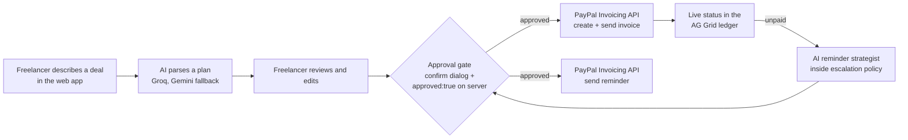

# Plainbill: AI invoice agent for freelancers

Plainbill turns a deal described in plain words, such as "Website redesign for Riverside Dental, priya@riverside.example, $1,500: 60% upfront, 40% in 30 days", into a PayPal instalment plan. You review and edit the plan, and nothing is sent until you approve it. Approved instalments become real PayPal invoices (sandbox), their live status shows in an AG Grid ledger, and when one is overdue an AI reminder strategist suggests a tone and message inside a fixed escalation policy. You edit and approve every reminder before it goes out.

**Live demo:** LIVE_URL_HERE · **License:** MIT

---

## The problem and who it's for

Freelancers and solo contractors often bill in instalments (a deposit, then the rest on delivery) and chase late payments by hand. That means retyping deal terms into an invoicing tool, tracking which instalment is due, and writing reminder emails that are neither too soft nor too aggressive. Plainbill handles the paperwork and suggests the reminder, while the freelancer keeps the final say on every invoice and every message.

## Features

- **Plain-language deal parsing.** The AI extracts client name, client email, total in USD and an instalment schedule. A missing email or amount is flagged, never guessed: an email only counts if it appears word for word in your text, and any non-USD currency is flagged.
- **Review, edit and approve.** Each instalment's name, amount, due date and the note printed on its PayPal invoice can be edited before approval. A "What your client receives now" preview shows the first invoice. Edited rows are marked "Edited by you".
- **Approval gate.** Every send (plan approval, next instalment, reminder) goes through a confirm dialog showing the amount and recipient, and the server rejects any send without `approved: true`.
- **PayPal invoices per instalment.** Instalment 1 is created and sent on approval. Later instalments are sent one at a time from the ledger.
- **AG Grid ledger.** One row per instalment with live PayPal status pills (Draft, Sent, Paid, Overdue, Not sent). On the Invoices page: column sorting, column filters (text, number, date), quick search, a status filter, pagination and CSV export. The Dashboard shows the six most recent rows.
- **Dashboard totals.** Outstanding, Paid and Overdue amounts.
- **AI reminder strategist.** Enter how many days the invoice is overdue (sandbox invoices never become overdue on their own). The AI returns a tone, a 1-2 sentence reasoning that names the days overdue and reminders sent, an editable message and a next action. The escalation policy is enforced in code (see [Safety design](#safety-design)).
- **Simulate payment (demo only).** Records an external payment on the latest unpaid invoice so the status can turn Paid without moving money.
- **Activity timeline.** Approvals and send times come from the server. Plan proposals, reminders and simulated payments are recorded in the browser's local storage, so they only appear in the browser where they happened.
- **"AI via" badge.** Shows which provider answered, and marks it when the fallback was used.

## How it works



1. The browser sends the deal text to `POST /api/deals/parse`. The server asks the AI for a fixed JSON shape, validates it and re-checks the email, amount and currency in code.
2. When you click **Approve and send** in the confirm dialog, the browser calls `POST /api/deals/approve` with `approved: true`. The server validates the plan, saves the deal to `data/deals.json`, then creates and sends invoice 1 through PayPal.
3. `GET /api/deals` reads each stored invoice ID and fetches its current status from PayPal, so PayPal is the source of truth for status.
4. For an unpaid invoice, `POST /api/deals/:id/reminder-strategy` returns the AI's advice after the escalation policy is applied. `POST /api/deals/:id/remind` sends the reminder through PayPal, and only with `approved: true`.

### API

| Method | Path | Body | Sends to client? |
|---|---|---|---|
| GET | `/api/config` | | No |
| POST | `/api/deals/parse` | `{text}` | No |
| POST | `/api/deals/approve` | `{plan, approved: true}` | Yes, invoice 1 |
| GET | `/api/deals` | | No |
| POST | `/api/deals/:id/instalments/:n/send` | `{approved: true}` | Yes, instalment n |
| POST | `/api/deals/:id/reminder-strategy` | `{days_overdue}` | No |
| POST | `/api/deals/:id/remind` | `{message, approved: true, tone?}` | Yes, reminder |
| POST | `/api/deals/:id/simulate-payment` | | No (records a demo payment) |

Errors are JSON: `{"error": {"code", "message", "details"}}`.

## Tech stack

- **Backend:** Node.js (20.6 or later) and Express 5. No database: deals are stored in a local JSON file.
- **Frontend:** plain HTML, CSS and JavaScript served by Express. No framework and no CDN; every asset, including AG Grid, is served from this server.
- **AI:** any OpenAI-compatible Chat Completions API, called with `fetch`.
- **Payments:** PayPal Invoicing API v2 (sandbox) over REST.

## Tools used and how each is used

| Tool | How it's used |
|---|---|
| **Groq** (primary AI) | Model `openai/gpt-oss-120b` through Groq's OpenAI-compatible endpoint. Parses deals and writes reminder advice. Requests use JSON mode, low reasoning effort and a 2,000-token output cap. |
| **Google Gemini** (fallback AI) | Gemini's OpenAI-compatible endpoint, tested with `gemini-3.5-flash-lite`. Used once per request only when Groq returns HTTP 429, a 5xx error or takes longer than 45 seconds. |
| **PayPal Invoicing API (sandbox)** | OAuth client-credentials token (cached until 60 seconds before expiry); create draft invoice; send invoice; get invoice for live status; send reminder (`/remind`); record a payment (`/payments`) for the demo-only "Simulate payment". |
| **AG Grid Community** 36 (MIT) | The invoices ledger: custom cell renderers for client, amount, instalment and status pills, sorting, column filters, quick search, pagination, CSV export, and a pinned actions column. Themed with AG Grid's Theming API. Only `ag-grid-community` is used; there is no Enterprise package. |
| **Kiro** | The AI coding assistant used to build this project: the backend, frontend, AG Grid integration, prompts and the test scripts used during development. |
| **Render** | Hosting for the live demo at LIVE_URL_HERE. |

## Safety design

- **Sandbox only.** The server refuses to start unless `PAYPAL_BASE_URL` points to `api-m.sandbox.paypal.com` or `api.sandbox.paypal.com`. All amounts are USD.
- **Approval gate.** `approve`, `instalments/:n/send` and `remind` return HTTP 403 `APPROVAL_REQUIRED` unless the request body contains `approved: true` (the boolean; the string `"true"` is rejected). In the UI, that flag is only sent from the confirm dialog's **Approve and send** button. A per-deal lock blocks two sends on the same deal at once.
- **Plan validation on the server.** A valid email; a total above $0 and up to $100,000; 1 to 12 instalments; percents that add up to 100; due dates 0 to 365 days out; instalment names of 1 to 120 characters; invoice notes up to 4,000 characters.
- **Escalation policy (enforced in code, not only in the prompt).**
  - 0-5 days overdue: at least **friendly**; 6-14 days: at least **firm**; 15 or more: **formal**.
  - The AI may choose a stricter tone only when 2 or more reminders were already sent for that invoice.
  - If the AI picks a softer tone, it is raised and marked "Tone raised by escalation policy"; a stricter tone without 2 earlier reminders is lowered. In both cases the message is rewritten for the final tone.
  - Inputs to the AI are only: client name, amount, instalment label, days overdue, reminders sent and the previous tone used.
  - Messages that mention late fees, interest, penalties, collections or legal action are rejected and retried. Messages must be under 90 words.
- **Recipient handling.** If `CLIENT_EMAIL` is set, every invoice and reminder goes to that sandbox buyer instead of the email parsed from the deal. The review panel and confirm dialog show the actual recipient.
- **No secrets in the repo.** Configuration comes only from environment variables; `.env` and `data/` are git-ignored, and `.env.example` holds placeholders. Error messages and logs pass through a redaction step that removes the PayPal secret, AI keys and access tokens, and logs record method, path, status and AI timing only, not prompts or keys.
- **Safe rendering.** All user and AI text is inserted with `textContent` or DOM nodes, never `innerHTML`.

## Local setup

You need Node.js 20.6 or later, a PayPal Developer account (free) and a Groq API key (free tier). A Gemini API key is optional.

1. **Clone and install**
   ```
   git clone https://github.com/harzy07/paypal-hackathon.git
   cd paypal-hackathon
   npm install
   ```
2. **Create a PayPal sandbox app.** In the [PayPal Developer Dashboard](https://developer.paypal.com/dashboard/), go to Apps & Credentials, switch to **Sandbox**, create an app and turn on **Invoicing** under Features. Under Testing Tools → Sandbox Accounts, note the email of a **personal** (buyer) sandbox account to use as `CLIENT_EMAIL`.
3. **Create your `.env`** from the example. `npm start` needs this file to exist.
   ```
   cp .env.example .env        # macOS / Linux
   copy .env.example .env      # Windows
   ```
   Then fill in the values:

   | Variable | Required | Description |
   |---|---|---|
   | `PAYPAL_CLIENT_ID` | Yes | Sandbox app client ID |
   | `PAYPAL_CLIENT_SECRET` | Yes | Sandbox app secret |
   | `PAYPAL_BASE_URL` | Yes | `https://api-m.sandbox.paypal.com` (other hosts are refused) |
   | `CLIENT_EMAIL` | Recommended | Sandbox buyer email. When set, all invoices and reminders go here |
   | `AI_BASE_URL` | Yes | Primary AI, e.g. `https://api.groq.com/openai/v1` |
   | `AI_API_KEY` | Yes | Primary AI key |
   | `AI_MODEL` | Yes | e.g. `openai/gpt-oss-120b` |
   | `AI2_BASE_URL` | No | Fallback AI, e.g. `https://generativelanguage.googleapis.com/v1beta/openai` |
   | `AI2_API_KEY` | No | Fallback AI key. Leave empty to run without a fallback |
   | `AI2_MODEL` | No | e.g. `gemini-3.5-flash-lite` |
   | `AI_PROVIDER`, `AI2_PROVIDER` | No | Display names for the "AI via" badge. Defaults to Groq / Gemini from the URL |
   | `AI_MODE` | No | `mock` returns labelled sample AI data with no provider calls (local development only; refused when `NODE_ENV=production`) |
   | `PORT` | No | Defaults to 3000 |

4. **Run**
   ```
   npm start
   ```
   Open http://localhost:3000. Locally the server only accepts connections from your own machine.

5. **Optional PayPal smoke test** (creates and sends one $100 sandbox invoice to `CLIENT_EMAIL`):
   ```
   node --env-file=.env scripts/phase1-test.js
   ```

## Testing instructions for judges

**Live demo:** LIVE_URL_HERE

The demo runs on Render's free plan, so the first request after a quiet period can take about 40 seconds while the service wakes up. If the page doesn't load, wait and refresh.

**How the demo client account works.** The demo is configured with `CLIENT_EMAIL`, so every invoice and reminder goes to one PayPal **sandbox** buyer account, whatever email you type in the deal. Sandbox invoices use test money only. Login details for that buyer account are in the Devpost testing instructions, not in this repo. With them, you can open an invoice's **Open client view** link (in the row menu) and sign in as the buyer to see the invoice as a client would.

**Suggested path (about 3 minutes):**

1. **New deal:** paste
   `Mobile app UI design for Riverside Dental, contact Priya at priya@riverside-dental.example. Total 1500 USD, 60% upfront and 40% after 30 days.`
   and click **Propose a plan**.
2. Check the plan, then click **Edit** on instalment 2 and change its amount, due date or invoice note. Read the "What your client receives now" preview.
3. Click **Approve and send instalment 1**, check the amount and recipient in the confirm dialog, then **Approve and send**.
4. **Invoices:** find the row in the AG Grid ledger. Try sorting, the search box, the status filter, a column filter and **Export CSV**.
5. Open the row's **⋯** menu → **Get reminder advice**. Try 3, 10 and 25 days overdue and watch the tone go friendly → firm → formal. Edit the message, then **Approve and send**.
6. **⋯** → **Simulate payment** (demo only) and watch the status change to Paid.
7. **Activity:** see the approvals, sends and reminders with timestamps.

To see the approval gate reject a send, call the API without the flag:
```
curl -X POST LIVE_URL_HERE/api/deals/<deal-id>/instalments/2/send -H "Content-Type: application/json" -d "{}"
```
It returns HTTP 403 `APPROVAL_REQUIRED`.

## Known limitations

- **Sandbox only.** No real money moves, and live PayPal mode is deliberately not supported. USD only.
- **PayPal reminder limits.** PayPal's API allows only 2 reminders per invoice per day, and its docs say the reminder note may be replaced with PayPal's standard text, so the client may not see the AI-written message word for word.
- **"Overdue" is simulated for reminders.** Sandbox invoices don't age, so reminder advice uses the days-overdue number you enter. The Overdue pill only appears once a real due date has passed.
- **Simulated payments.** "Simulate payment" records an external payment through PayPal's API. It does not take a payment from the buyer.
- **Free-tier AI limits.** Groq and Gemini free tiers have rate limits. The app falls back to Gemini on HTTP 429, 5xx or a 45-second timeout. Other errors, such as Groq returning 403 "Access denied" from some networks or VPNs, are shown as errors and do not trigger the fallback.
- **Regional PayPal rules.** PayPal blocks some invoice routes; for example, a sandbox business account registered in India cannot invoice a recipient in India.
- **Storage.** Deals are kept in `data/deals.json`. On a host without a persistent disk, such as Render's free plan, that file is reset when the service restarts. The invoices themselves remain in PayPal.
- **No user accounts.** Anyone with the demo link uses the same demo data and sandbox buyer.
- **Activity timeline.** Plan proposals, reminders and simulated payments are recorded in the browser's local storage, so they only appear in the browser where they happened.
- **Edits only before approval.** After a plan is approved, the amounts, dates and notes of unsent instalments can't be changed.

## License

Released under the [MIT License](LICENSE).
